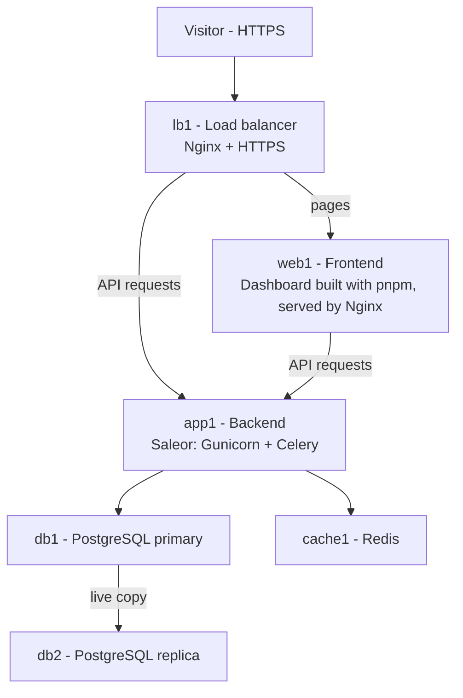

# E-Commerce Platform with Ansible

One command turns a set of fresh Ubuntu servers into a working online shop.
The project (course: Infrastructure Programming, FINKI) automates a multi-tier
**Saleor** e-commerce platform: database, backend, frontend, cache and a load balancer.

---

## 1. What gets built



| Tier | What it does | Technology | Staging VM |
|---|---|---|---|
| Load balancer | Entry point, HTTPS, spreads traffic | Nginx | lb1 (192.168.56.108) |
| Frontend | The admin dashboard (React) | Nginx + files built with pnpm | web1 (192.168.56.109) |
| Backend | Shop logic and API | Saleor (Django), Gunicorn, Celery | app1 (192.168.56.110) |
| Cache | Fast storage and task queue | Redis | cache1 (192.168.56.111) |
| Database | Stores all shop data | PostgreSQL primary + replica | db1 (.113), db2 (.112) |

---

## 2. How I set up my lab

- A Windows PC running **VirtualBox**.
- **6 target VMs** (Ubuntu 24.04, visit osboxes.org for the VM images), one per row in the table above.
- **1 control VM called `ansible-control`**. Ansible runs only here. It connects to the
  other six over SSH and does all the work. Nothing is installed by hand on the targets.
- All VMs are on the same VirtualBox "host-only" network (`192.168.56.0/24`) so they can
  talk to each other, plus a normal adapter so they can download packages.
- Memory: most VMs have about 1 GB. `web1` has 4 GB, because building the dashboard is heavy.
  `app1` has more than the others too.

**Why a separate control VM?** I first considered WSL2 and Vagrant, but WSL2 sits behind its
own network and has trouble reaching the VirtualBox network. A plain Ubuntu VM on the same
network just works, and it is also a realistic setup: one admin machine managing many servers.

### Getting started (from scratch)

```bash
# 1. On the control VM: install Ansible and create an SSH key
ssh-keygen -t ed25519

# 2. Copy the key to each target VM and allow passwordless sudo (see "Problems" below)
ssh-copy-id <user>@192.168.56.108   # repeat for .109 .110 .111 .112 .113

# 3. Get the project and the ready-made roles it uses
git clone <this repository> && cd ecommerce-ansible
ansible-galaxy install -r requirements.yml -p galaxy_roles
ansible-galaxy collection install -r requirements.yml -p galaxy_collections

# 4. Secrets (see section 6)
echo 'PLACEHOLDER_FOR_VAULT_PASS' > .vault_pass && chmod 600 .vault_pass

# 5. Check that Ansible can reach everything, then build the whole system
ansible all -i inventory/staging -m ping
ansible-playbook site.yml -i inventory/staging
```

Then add `192.168.56.108 shop.staging.local` to your `hosts` file and open
`https://shop.staging.local/dashboard/` (accept the certificate warning, it is self-signed).

---

## 3. How the project is organised

```
site.yml            builds everything (the main playbook)
rolling-update.yml  updates the backend one server at a time
teardown.yml        wipes the target VMs so you can start over (staging only)
inventory/          the list of servers, one folder per environment
  staging/            my 6-VM lab
  production/         the full-size layout (12 servers)
roles/              the four roles I wrote myself
requirements.yml    the ready-made roles downloaded from Ansible Galaxy
```

### Inventories (staging and production)

An **inventory** is simply the list of servers and which job each one has. Mine are sorted
into groups: `lb`, `web`, `app`, `db`, `cache`. Each environment has its own folder:

- `hosts.yml` – which servers exist and which group they belong to.
- `host_vars/` – one small file per server (its IP address).
- `group_vars/` – settings shared by a group (for example, the database name or the domain).

**Staging** is my real lab: one server per tier, plus a primary and a replica database.
**Production** describes the full layout from the assignment (2 load balancers, 3 frontends,
3 backends, 2 databases, 2 Redis). It uses the same roles, only with different servers and
settings, for example a real Let's Encrypt certificate instead of a self-signed one.

---

## 4. The roles I wrote

| Role | What it does, in plain words |
|---|---|
| **django-app** | Downloads Saleor from GitHub, installs its Python libraries, writes its settings file, sets up the database tables, and runs the app as a background service (plus the Celery worker). It waits until the app reports it is healthy. |
| **frontend-deploy** | Downloads the dashboard, builds it, copies the finished website into Nginx, and configures Nginx to forward API requests to the backend. |
| **lb-config** | Sets up the load balancer. It builds the list of backend servers automatically from the inventory, handles HTTPS, limits request rates, and can temporarily "drain" a server during updates. |
| **db-replication** | Makes the second database an exact live copy of the first. It creates the replication user, copies the data across on the first run, and then checks that replication is really working. |

I also use ready-made roles from Ansible Galaxy for the standard parts: PostgreSQL, Nginx,
Redis, Node.js, Python pip and Certbot (certificates, used in production).

Things the roles share:
- **Templates**: configuration files with blanks (such as the IP addresses) that Ansible fills in.
- **Handlers**: "restart this service" actions that run only when a config file actually changed.
- **Safe to repeat**: running the playbook again changes nothing if everything is already correct.

---

## 5. Updating without downtime (rolling update)

```bash
ansible-playbook rolling-update.yml -i inventory/production --limit app -e rollout_version=3.23.41
```

For each backend server, one at a time: remove it from the load balancers, install the new
version, wait for the health check to pass, and put it back. Users keep being served by the
other servers. If the health check fails, the server is rolled back to the previous version
and the update stops. (Database changes made by a new version are not undone.)

My staging lab has only one backend server because of limited memory, so the effect is fully
visible only in production, which defines three.

---

## 6. Secrets (Ansible Vault)

Passwords and keys live in `inventory/<env>/group_vars/all/vault.yml`, **encrypted**.
The other files refer to them by name, so no password appears in plain text in the repository.

```bash
ansible-vault encrypt inventory/staging/group_vars/all/vault.yml
ansible-vault view    inventory/staging/group_vars/all/vault.yml
ansible-vault edit    inventory/staging/group_vars/all/vault.yml
```

The vault password is stored in `.vault_pass`, which is **not** committed (it is in `.gitignore`).
The app's signing key is generated on the control VM into `.generated/` (also not committed).

---

## 7. Starting again from a clean system

`ansible-playbook teardown.yml -i inventory/staging -e confirm_teardown=yes`removes everything this project installed.

---

## 8. Problems I ran into and how I solved them

| Problem | Cause | Fix |
|---|---|---|
| Ansible could not connect: "Host key verification failed" | The control VM had never seen the new servers | Added their fingerprints with `ssh-keyscan` |
| "Vault password file not found" | `.vault_pass` did not exist yet | Created it (and kept it out of Git) |
| "Permission denied (publickey)" | The VMs used the user `osboxes`, not `vagrant`, and had no copy of my key | Set `ansible_user: osboxes`, ran `ssh-copy-id`, and allowed passwordless sudo |
| Saleor download failed: "3.20 not found" | That branch does not exist any more | Used a real release tag (`3.23.40`) |
| Backend crashed: "No module named pytest" | Saleor needs some development libraries even in production | Install with `uv sync --locked`, the way Saleor's own Docker image does |
| Backend refused to start: "RSA_PRIVATE_KEY not provided" | Saleor needs a signing key in production | Ansible generates one on the control VM and copies it to every backend through a small launcher script |
| Gunicorn error about the worker class | The class used in older Saleor versions was removed | Switched to `uvicorn.workers.UvicornWorker` |
| Dashboard build never finished | The VM had 1 GB RAM and was constantly swapping to disk | Gave `web1` 4 GB RAM and a swap file |
| Dashboard build crashed: "heap out of memory" | I had capped Node's memory too low | Raised the limit to 6 GB |
| Dashboard needed different tools | This version requires Node 24 and pnpm, not npm | Updated the frontend role to install both |

---

